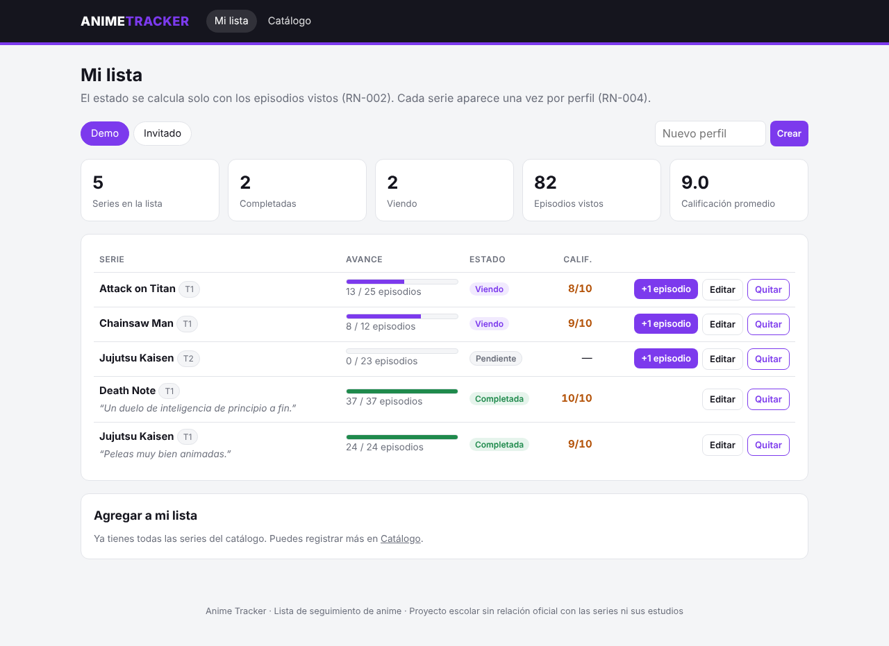
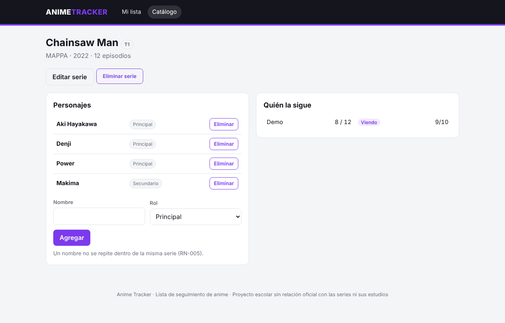
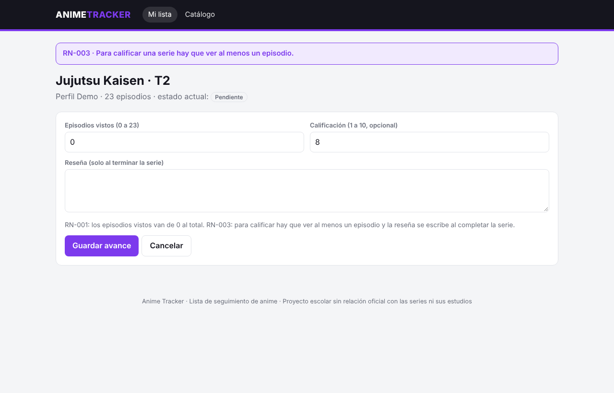
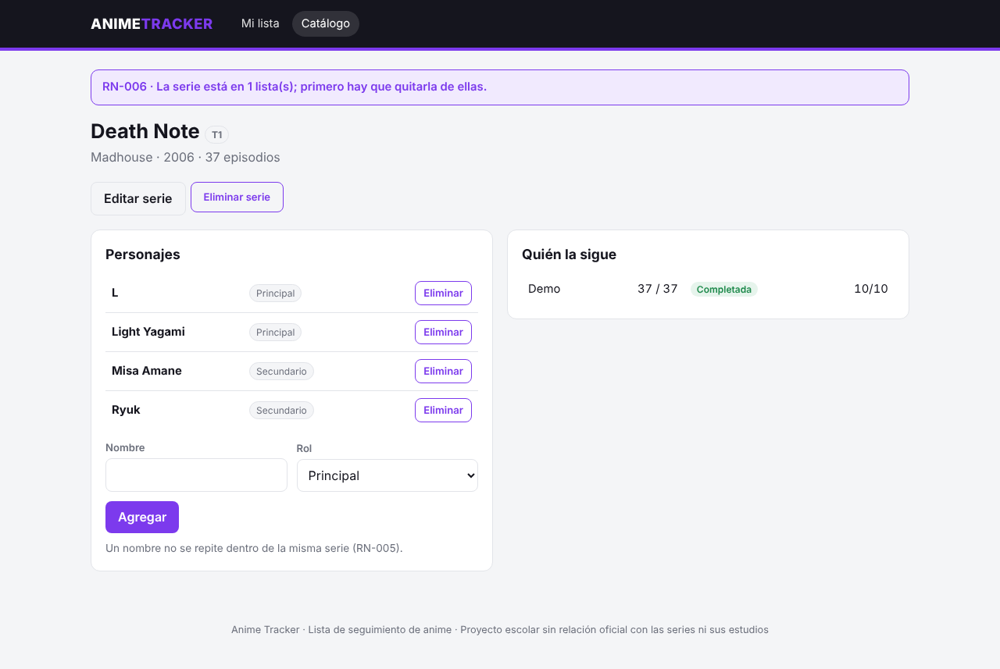

# Anime Tracker · Documentación

**Versión 1.0** · Aplicación web en Python para llevar una lista de seguimiento de anime por perfil.

## 1. Descripción

Anime Tracker permite que cada perfil lleve su lista de series: cuántos episodios ha visto, en qué estado va cada una, su calificación y su reseña. También mantiene un catálogo de series y temporadas con sus personajes.

**Usuario:** cualquier persona que quiera llevar el registro de lo que ve. Cada perfil tiene su propia lista. No hay inicio de sesión: los perfiles se eligen desde la pantalla principal.

**Alcance:** series de anime por temporada. Fuera de alcance: películas, imágenes de las series, recomendaciones automáticas y cuentas con contraseña.

## 2. Tecnología

| Capa | Herramienta |
|---|---|
| Lenguaje | Python 3.11+ |
| Web | Flask 3 con plantillas Jinja2 (HTML renderizado en el servidor) |
| Base de datos | SQLite (módulo `sqlite3` de Python) |
| Servidor en producción | Gunicorn |
| Pruebas | pytest |
| Despliegue | Render (`render.yaml`) o cualquier plataforma con `Procfile` |

## 3. Requerimientos funcionales

| Clave | Requerimiento |
|---|---|
| RF-01 | Registrar, consultar, editar y eliminar series y temporadas (título, temporada, estudio, año y episodios). |
| RF-02 | Registrar, consultar y eliminar personajes de una serie (nombre y rol). |
| RF-03 | Crear perfiles y cambiar entre ellos. |
| RF-04 | Agregar series a la lista de un perfil y quitarlas. |
| RF-05 | Registrar el avance de una serie: episodios vistos, calificación y reseña; botón para sumar un episodio. |
| RF-06 | Calcular el estado de cada serie de la lista y un resumen del perfil. |
| RF-07 | Avisar en pantalla, con la clave de la regla, cuando una operación incumple una regla de negocio. |

## 4. Historias de usuario

| Clave | Historia |
|---|---|
| HU-01 | Como administrador del catálogo, quiero registrar series y temporadas con su número de episodios. |
| HU-02 | Como usuario, quiero agregar series a mi lista para llevar lo que estoy viendo. |
| HU-03 | Como usuario, quiero marcar los episodios que veo para saber en qué voy. |
| HU-04 | Como usuario, quiero calificar y reseñar las series para recordar qué me parecieron. |
| HU-05 | Como administrador del catálogo, quiero registrar los personajes de cada serie. |

## 5. Reglas de negocio

Programadas en `app/reglas.py`. Cada una tiene pruebas en `tests/test_reglas.py` con su clave en el nombre de la prueba (por ejemplo, `test_rn002_...`).

| Clave | Regla | Severidad | Historia | Criterio de aceptación |
|---|---|---|---|---|
| RN-001 | Los episodios vistos van de 0 al total de la temporada; el botón +1 no pasa del total. | Alta | HU-03 | Dada Chainsaw Man T1 con 12 episodios, cuando se capturan 13 vistos, entonces se rechaza con el aviso RN-001. |
| RN-002 | El estado se calcula: Pendiente con 0 episodios, Viendo con al menos 1, Completada al llegar al total. No se captura a mano. | Media | HU-03 | Dada una serie de 12 episodios, cuando se marcan 12 vistos, entonces el estado es Completada. |
| RN-003 | La calificación va de 1 a 10 y requiere haber visto al menos un episodio; la reseña solo se escribe con la serie completada. | Media | HU-04 | Dada una serie en Pendiente, cuando se califica con 8, entonces se rechaza con el aviso RN-003. |
| RN-004 | Una serie aparece una sola vez en la lista de cada perfil; otro perfil sí puede agregarla. | Media | HU-02 | Dada Death Note en la lista del perfil Demo, cuando se agrega otra vez, entonces se rechaza con el aviso RN-004. |
| RN-005 | El nombre de un personaje no se repite dentro de la misma serie (sin distinguir mayúsculas). | Baja | HU-05 | Dado Denji en Chainsaw Man, cuando se registra «denji» en la misma serie, entonces se rechaza con el aviso RN-005. |
| RN-006 | Una serie que está en la lista de algún perfil no se elimina del catálogo. | Alta | HU-01 | Dada Death Note en una lista, cuando se intenta eliminar, entonces se rechaza con el aviso RN-006. |
| RN-007 | El total de episodios de una serie no baja de lo visto por cualquier perfil; al cambiarlo se recalcula el estado de todos. | Media | HU-01 | Dados 10 episodios vistos, cuando el total se cambia a 9, entonces se rechaza con el aviso RN-007. |

## 6. Casos de uso

### CU-01 Agregar una serie a mi lista
- **Actor:** usuario.
- **Flujo principal:** 1) En *Mi lista* elige su perfil. 2) En *Agregar a mi lista* elige la serie. 3) Presiona *Agregar*. 4) El sistema valida RN-004, la agrega en estado Pendiente (RN-002) y muestra «Serie agregada a tu lista.».
- **Flujo alterno:** si la serie ya está en su lista, no se agrega y se muestra el aviso RN-004.

### CU-02 Registrar avance
- **Actor:** usuario.
- **Flujo principal:** 1) Presiona *+1 episodio*, o *Editar* para capturar episodios, calificación y reseña. 2) El sistema valida RN-001 y RN-003, calcula el estado (RN-002) y guarda.
- **Flujo alterno:** si los episodios salen del rango, se califica sin haber visto nada o se reseña sin terminar, no se guarda y se muestra el aviso.

### CU-03 Administrar el catálogo
- **Actor:** administrador del catálogo.
- **Flujo principal:** 1) En *Catálogo* registra una serie o temporada. 2) Desde la serie edita sus datos, agrega personajes (RN-005) o la elimina (RN-006).
- **Flujo alterno:** si el nuevo total de episodios es menor a lo que alguien ya vio, no se guarda y se muestra el aviso RN-007.

## 7. Modelo de datos

| Tabla | Campos | Restricciones |
|---|---|---|
| series | id, titulo, temporada, estudio, anio, episodios | (título, temporada) único; episodios > 0 |
| personajes | id, serie_id, nombre, rol | se borran con su serie; nombre único por serie (RN-005) |
| perfiles | id, nombre | nombre único |
| seguimiento | id, perfil_id, serie_id, vistos, estado, calificacion, resena, actualizado | (perfil, serie) único (RN-004) |

## 8. Arquitectura

```
Navegador ──HTTP──▶ rutas.py (pantallas) ──▶ reglas.py (reglas de negocio) ──▶ SQLite
                         │                          │
                    templates/ (HTML)        ReglaNegocioError("RN-###")
```

Toda escritura a la base de datos pasa por `reglas.py`. Si una operación incumple una regla, se lanza `ReglaNegocioError` con la clave de la regla y la pantalla la muestra como aviso, sin guardar nada.

## 9. Pruebas

32 pruebas automatizadas con pytest, todas en verde:

- `tests/test_reglas.py`: al menos una prueba por regla RN-001 a RN-007.
- `tests/test_web.py`: que cada pantalla cargue, que el CRUD funcione desde la web y que los avisos RN-001, RN-004 y RN-006 aparezcan.

Para correrlas: `pytest`. Solo las de reglas: `pytest -k rn -v`.

## 10. Despliegue

El repositorio incluye `render.yaml` para desplegar en Render con el plan gratuito (New + → Blueprint). El paso a paso está en el `README.md`. En el plan gratuito la base de datos vuelve a los datos de ejemplo cada vez que el servicio se reinicia.

## 11. Capturas


*Lista del perfil Demo con su resumen, avance y estado calculado.*


*Detalle de Chainsaw Man: personajes y quién la sigue.*


*RN-003: calificar una serie sin haber visto ningún episodio.*


*RN-006: eliminar una serie que está en una lista.*
